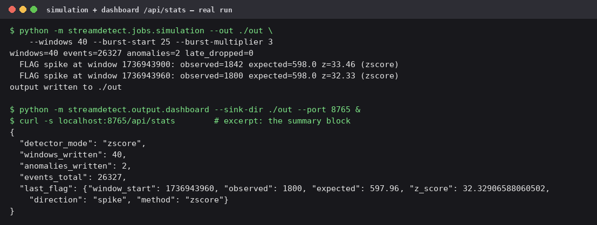

# Streaming Anomaly Detection — Wikimedia Event Stream

Watches Wikipedia's edit stream as it happens and flags the minutes when
something unusual is going on.

## What this does, in plain words

Wikipedia and its sister projects are edited thousands of times a day, and
every edit is published on a public live feed. This program listens to that
feed, counts how many edits arrive in each one-minute window, and keeps a
running sense of what "normal" looks like. When a minute's count is way off
from normal — a sudden burst, or a sudden silence — the program flags it
and shows it on a small live dashboard, along with how long the edits took
to arrive and which wikis the edits came from.

Why it matters: this is the shape of a lot of real data engineering work.
Fraud systems, traffic monitors, and service health checks all do the same
three things — take a stream that never stops, summarise it in windows,
and notice when the summary stops looking like the recent past. I built it
on Wikipedia's feed because it's public, it's real, and it never sleeps,
so there's always something to test against.

## What counts as an anomaly here

Precisely, because "anomaly detection" without a definition is
hand-waving:

- **The signal** is the number of edits in one closed **one-minute
  window**, all wikis combined. (The per-wiki split is recorded for every
  window, and shown on the dashboard, but not judged separately.)
- **The baseline** is the mean and standard deviation of the previous
  **60 clean windows**. Flagged windows are kept out of the baseline, so
  a burst can't raise the bar for the window after it.
- **The rule**: a window is flagged when its count sits at least **3
  standard deviations** from the baseline — a *spike* above it, a *drop*
  below it.
- **Two adjustments that matter.** Nothing is judged until 5 baseline
  windows exist (warmup — a z-score from three windows is a random number
  with confidence). And the baseline's standard deviation is floored at
  the square root of its mean: counts of arriving events can't be less
  spread out than a Poisson process, so a too-quiet baseline must not be
  allowed to make ordinary wobble look like a 3-sigma event. My first
  version had exactly that bug; the tests caught it.

Why 3σ: at roughly 600 edits a minute, the floor alone puts σ near 24,
so a flag needs a swing of about ±75 edits sustained over a full minute —
well outside minute-to-minute noise — while a real 3x burst scores
z ≈ 33, as the run further down shows. Latency (mean and p95 per window)
is recorded and displayed next to every flag, but this version judges
volume only; a latency detector is an obvious next step, not something
pretended here. The detector also has EWMA and combined modes; the
details are under [How detection works](#how-detection-works).

## How it works, step by step

1. **Edits are collected.** A producer program subscribes to Wikimedia's
   live feed (or generates fake traffic, for testing) and puts each edit
   on a message queue.
2. **Edits are grouped into one-minute windows.** A streaming program
   counts each minute's edits, works out the average and 95th-percentile
   arrival delay, and breaks the count down by wiki.
3. **Each minute is judged.** The count is compared against a baseline
   built from the minutes before it. Too far from the baseline — in either
   direction — and the minute is flagged.
4. **Results are written to files.** Every window and every flag goes to
   simple log files, plus a small summary file and a spreadsheet-style
   Parquet copy for later analysis.
5. **A dashboard shows it live.** A tiny web page refreshes every two
   seconds: current rate, delays, the per-wiki breakdown, the chart, and
   the history of flagged minutes.

If part of the stream sends a broken message — and real streams do — the
producer doesn't crash. It counts the bad message and saves it to a
separate "dead letter" file so I can look at what broke later.

```
  Wikipedia's live edit feed
        |
        v
  [ producer ] ---> [ Kafka queue ] ---> [ Spark streaming job ]
   (or fake traffic)                      groups edits into
                                          1-minute windows
                                                 |
                                                 v
                                    [ detector: is this minute
                                      normal for recent traffic? ]
                                                 |
                                                 v
                              [ files: window log, flags, summary,
                                Parquet copy ]
                                                 |
                                                 v
                                    [ dashboard web page ]
```

## Broken messages go to a dead-letter file

A payload that arrives but fails validation — the feed's schema drifts
and a field disappears, say — must not kill the stream or vanish
silently. The producer counts it, logs it, and writes it verbatim to a
dead-letter file (raw line, the validation error, when it arrived) while
the stream keeps running. An actual record, produced by feeding the
parser a recentchange line with its `id` field missing:

```json
{"received_at": 1736943900.0, "error": "recentchange payload has no id", "raw": "data: {\"type\": \"edit\", \"title\": \"Example\", \"user\": \"SomeEditor\", \"wiki\": \"enwiki\", \"timestamp\": 1736943900}"}
```

That file is the point: when upstream changes its schema, the evidence
of what broke and what was skipped is sitting there, instead of a silent
gap in the windows. Payloads with null fields land there too (they used
to crash the parser — there's a regression test). Lines that were never
data at all — SSE heartbeats and comments, normal stream chatter — are
skipped, not dead-lettered.

## When the feed drops

It does, regularly. `WikimediaEventSource` reconnects on its own: up to
5 retries, waiting 2 s × the attempt number (2, 4, 6, 8, 10 s), logging
each drop with the reason. If the feed is still down after that, the
producer raises and exits — a dead producer you can see beats a silent
one. On the Kafka path, a consumer being down loses nothing: events wait
in the topic, and the Spark job resumes from its checkpointed offsets
when it comes back.

## The pieces, in technical terms

The stack, with what each bit is and why it's here:

- **Wikimedia EventStreams** — Wikimedia's public feed of edits, pushed
  over a technology called server-sent events (a server keeping an HTTP
  connection open and sending updates as they happen).
- **Apache Kafka** — a message queue built for streams: the producer
  writes edits to a named "topic", and consumers read them at their own
  pace. It sits between collecting and processing so a slow processor
  doesn't lose data.
- **Apache Spark Structured Streaming** — a stream-processing engine; it
  does the one-minute grouping at scale. (Java is required to run it —
  more on that under limitations.)
- **Parquet** — a compact column-oriented file format, the standard way to
  hand tabular data to analysis tools.
- **Pydantic** — a validation library. Every incoming edit becomes a
  pydantic model at the boundary, so a message with a missing or
  wrong-typed field is rejected (and dead-lettered) instead of crashing
  something downstream.
- **Docker Compose** — one file describing the whole local stack. Kafka
  and the dashboard start with a single command; the producer joins in
  simulate mode behind a compose profile, so a plain `docker compose up`
  doesn't generate fake traffic you didn't ask for.
- Plain **Python** for the detector itself, on purpose — see below.

The package is split by concern — core logic, getting data in, getting
data out, and the runnable jobs:

| Module | What it does |
|---|---|
| `streamdetect/ingest/events.py` | `parse_recentchange()` — turns a raw feed message into a tidy `StreamEvent`, including its arrival delay |
| `streamdetect/ingest/producer.py` | The feed consumer (reconnects when the feed drops) and the fake-traffic generator; Kafka, file, and stdout outputs; `DeadLetterSink` for broken messages |
| `streamdetect/core/windowing.py` | `TumblingWindowAggregator` — the one-minute grouping in plain Python; `merge_window_partials()` folds Spark's per-wiki rows back into one window |
| `streamdetect/core/detection.py` | The detectors: `RollingZScoreDetector`, `EWMADetector`, `CombinedDetector`, all built by `build_detector()` |
| `streamdetect/jobs/spark_job.py` | The real streaming job: Kafka → window aggregates → detector → sink |
| `streamdetect/output/sink.py` | `JsonlStatsSink` — writes the window log, the flags log, the summary file, and the optional Parquet copy |
| `streamdetect/output/dashboard.py` + `dashboard.html` | The monitoring page, served by Python's built-in web server — no framework, no build step |
| `streamdetect/jobs/simulation.py` | Runs the whole pipeline locally with fake traffic — the demo and the end-to-end test in one |

## The same walkthrough, with the code names

The producer's `WikimediaEventSource.stream()` reads the server-sent
events feed and runs each line through `parse_sse_data()` /
`parse_recentchange()`; a payload that fails validation raises
`ValueError`, gets counted, and goes to the `DeadLetterSink` instead of
killing the loop. Good events are published to the Kafka topic
`wikimedia.recentchange`, keyed by wiki. The Spark job parses each record
against `EVENT_SCHEMA`, derives ingestion latency from the broker
timestamp, applies a 2-minute watermark, and groups by (window, wiki),
aggregating count, mean latency, and `percentile_approx` p95. In
`foreachBatch`, `make_batch_handler()` folds each window's per-wiki rows
into a single `WindowStats` (`merge_window_partials()`), writes it through
the sink, and calls `detector.observe()`. A returned `AnomalyFlag` is
written with its window's latency stats. The dashboard's
`build_stats_payload()` reads the sink files fresh on every request, so
what you see is never staler than the last closed window.

Without a JVM or broker, `jobs/simulation.py` replays the same semantics:
synthetic events flow through `TumblingWindowAggregator` in micro-batches,
get judged by the same detector, and land in the same sink — which is why
I can test the pipeline's behaviour anywhere.

## How detection works

For each closed one-minute window, the detector compares the edit count
against a baseline from earlier windows. Three modes, picked by
configuration:

- **zscore** (the default) — the baseline is the mean and standard
  deviation of the last 60 clean windows. A window at least 3 standard
  deviations out is flagged, as a *spike* or a *drop*. Flagged windows are
  kept out of the baseline, so one burst can't hide the next one.
- **ewma** — an exponentially weighted average, which is a baseline that
  slowly forgets: recent windows count more. Wikimedia traffic rises and
  falls over the day, and this baseline drifts with it instead of lagging.
  It absorbs flagged windows on purpose — adapting is its whole job.
- **both** — the two detectors run side by side and a window is flagged
  only when they agree. I added this after watching the single detectors
  fail in opposite ways: z-score stays jumpy after a genuine level shift;
  EWMA is slow to call a spike that builds gradually. Requiring agreement
  costs a little sensitivity and buys a much quieter dashboard.

Two guards keep the false alarms down, and both were earned the hard way:

- **Warmup.** Nothing is judged until 5 baseline windows exist. A
  z-score computed from three windows is a random number with confidence.
- **The sigma floor.** My first version of this flagged ordinary noise,
  and the tests caught it: with a short baseline, the *estimated* standard
  deviation can come out far smaller than the real one, so a perfectly
  normal wobble scored as a 3.7-sigma event. Edit counts can't be less
  spread out than a Poisson process (the maths of random arrivals), so
  the baseline's sigma is now floored at the square root of its mean. A
  wobble stopped tripping the alarm; a real 3x burst still scores
  z ≈ 33–50.

A later line-by-line audit found three more bugs of the same flavour,
each now pinned down by a test. The EWMA detector refused to judge at
all after perfectly flat traffic (its variance sat at exactly zero, so
even a jump from 600 to 5,000 edits a minute went unflagged) — the
sigma floor fixed that too, once I let it judge. A very late event
could open a window in the past that had never existed and get it
emitted as if it were current; late events are now dropped against a
watermark, like Spark does. And the feed parser crashed outright on
messages with null fields — one odd message would have killed the
stream — where it now dead-letters them like any other bad payload.

Latency (mean and p95 per window) is recorded and shown, and joins each
flag in the log — but flagging is on volume. A latency-only detector is
an obvious next step, not something this version pretends to do.

## Try it without Kafka or Spark

Python 3.10+, nothing else needed:

```bash
python -m venv .venv && .venv/bin/pip install -r requirements.txt

# 40 windows of fake traffic, with a 3x burst injected at window 25:
.venv/bin/python -m streamdetect.jobs.simulation --out ./out \
    --windows 40 --burst-start 25 --burst-multiplier 3
```

```
windows=40 events=26327 anomalies=2 late_dropped=0
  FLAG spike at window 1736943900: observed=1842 expected=598.0 z=33.46 (zscore)
  FLAG spike at window 1736943960: observed=1800 expected=598.0 z=32.33 (zscore)
output written to ./out
```

Exactly two flags — the two burst windows — and nothing else. Add
`--detector-mode both` to watch the combined detector work the same run.

Then look at it:

```bash
.venv/bin/python -m streamdetect.output.dashboard --sink-dir ./out --port 8765
# -> http://127.0.0.1:8765
```

The dashboard page is a small live HTML view; what it serves comes
straight from the sink files. A captured excerpt of its `/api/stats`
answer from exactly the run above — note the totals reconcile with the
simulation (40 windows, 26,327 events, 2 anomalies), and `last_flag`
still holds the second burst window, because a flag stays in the summary
until a newer one replaces it:



## The full pipeline, with Kafka and Spark

`docker-compose.yml` starts a local Kafka broker, the dashboard, and
(optionally) the producer in simulate mode:

```bash
docker compose up -d kafka dashboard
docker compose --profile simulate up producer   # fake traffic into Kafka
```

The Spark job runs on the host — it needs a Java runtime (JVM) and the
Spark Kafka connector package:

```bash
spark-submit --packages org.apache.spark:spark-sql-kafka-0-10_2.13:4.3.0 \
    -m streamdetect.jobs.spark_job \
    --bootstrap-servers localhost:29092 --topic wikimedia.recentchange \
    --output-dir ./out --checkpoint-dir ./checkpoint
```

To use the live feed instead of fake traffic, run the producer with
`--mode live` (add `--dead-letter dead.jsonl` to keep the broken
messages). Full commands are in the header of `docker-compose.yml` and in
`ingest/producer.py` / `jobs/spark_job.py` themselves.

One honest note: the compose file is configuration, and the machine I
built this on has no Docker daemon — so I verified the file by parsing
it, not by bringing the stack up. The Spark job is in the same boat
here (no JVM on this machine): it's complete, and it imports cleanly
against PySpark 4.3, but its window/detection path is verified through
the local simulation, which runs the same aggregation and detection
code. `VALIDATION.md` spells out exactly what was run and checked here.

## Tests

```bash
.venv/bin/python -m pytest
```

54 tests, all offline — no broker, no JVM, no live feed. The detectors
are fed series with known behaviour (steady traffic must never flag;
flat traffic followed by a spike must flag — that one is a regression
test for a real bug; injected spikes and drops must flag in the right
windows; the combined mode must stay quiet where only one detector
calls it). Windowing tests check the statistics exactly — a
hand-computed mean of 200.0 and p95 of 290.0 — plus the per-wiki counts,
the late-event watermark, and the partial-row merging the Spark job
depends on. The producer tests run against a recorded real feed
message, and a stubbed feed proves broken messages — including ones
with null fields — land in the dead-letter file while the stream keeps
going. The dashboard tests start the real server on a spare port. The
end-to-end tests run the seeded simulation and reconcile the sink files
— JSON lines, summary, and the Parquet copy — against the run. GitHub
Actions runs the suite, plus a simulation smoke check, on every push.
The `Makefile` wraps the everyday commands (`make test`, `make sim`,
`make dashboard`, `make lint`, `make types` — black, ruff, and mypy are
configured in `pyproject.toml` and currently clean).

## Decisions and trade-offs

- **The detector is plain Python, and that's the architecture, not a
  shortcut.** Spark calls it on the driver, one window at a time, so the
  baseline stays in one place and in order. The trade: a driver restart
  resets the baseline and the detector warms up again for 5 windows.
  Persisting the baseline in the checkpoint is the known fix, and it's
  written down in `spark_job.py` rather than half-done.
- **Fixed one-minute windows.** Simple, and they match how people read
  the dashboard ("edits per minute"). A burst that straddles a boundary
  splits across two windows and scores lower in each. Sliding windows
  fix that at roughly 60x the state; not worth it here.
- **Late data gets dropped, and counted.** Spark uses a 2-minute
  watermark; the local aggregator does the same thing by hand and keeps
  a `late_dropped` counter, because silently losing data is how
  pipelines lie to you.
- **The sink is files, not a database.** Appending lines survives
  crashes, tails easily, and keeps the dashboard dependency-free. The
  Parquet copy is rebuilt from the log each window — fine at one row a
  minute, not a pattern for high-rate streams. Neither would scale past
  one machine, and that's accepted scope for this project.
- **The Spark p95 is an approximation, labelled as one.** Grouping by
  wiki means a window's overall p95 gets merged from per-wiki p95s, and
  percentiles don't merge exactly — the code takes the max and says so.
  The local path computes the exact p95 from raw delays.

## Layout

```
streamdetect/
  core/           windowing.py, detection.py
  ingest/         events.py, producer.py
  output/         sink.py, dashboard.py, dashboard.html
  jobs/           spark_job.py, simulation.py
tests/            the pytest suite + a recorded feed message
docs/             dashboard-stats.png — captured output from a real run
Makefile          make test / sim / dashboard / lint / types
Dockerfile, docker-compose.yml   Kafka + producer + dashboard stack
.github/workflows/ci.yml   tests on every push
VALIDATION.md     the final validation runs, with screenshots
validation/       the captured output behind VALIDATION.md
```

## License

MIT — see `LICENSE`. Event data is from the Wikimedia EventStreams
public feeds.
