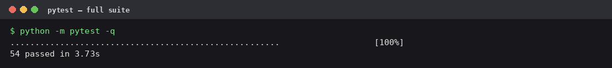
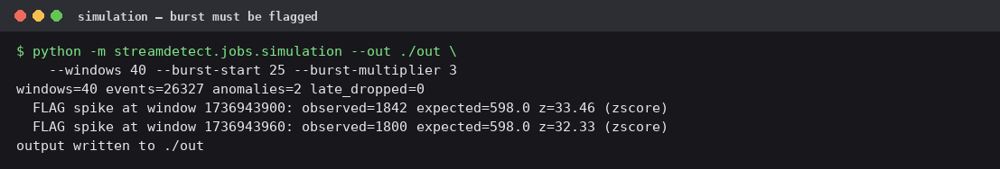
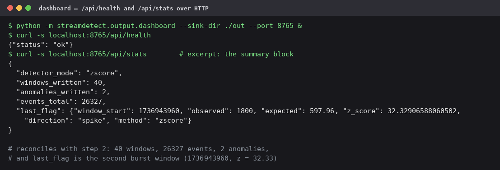

# Validation

The final checks, run against the finished code on 2026-11-06. This file
is evidence, not a setup guide: every number the README quotes comes from
one of these runs. Each image is the real terminal output of the command
shown, captured as it happened.

What's *not* covered here, stated plainly: the Spark job and the Docker
stack. This machine has no JVM and no Docker daemon, so the Spark job is
verified by importing cleanly against PySpark 4.3 and by the simulation
below, which runs the same aggregation and detection code. The compose
file is verified by parsing it, not by bringing the stack up.

## 1. The full test suite

54 tests, all passing, all offline. Detectors fed series with known
behaviour (steady traffic must never flag; a spike after perfectly flat
traffic must — that's a regression test for a real bug), exact windowing
statistics, the late-event watermark, malformed payloads landing in the
dead-letter file, the sink's files reconciling with each other, and the
dashboard served for real on a spare port.

## 2. The simulation, with the burst switched on

Forty windows of synthetic traffic, a 3x burst injected at windows 25–26.
Exactly two flags — the two burst windows, at z = 33.46 and z = 32.33 —
and zero false positives on the other 38. This is the same scenario CI
runs, and the CI step now asserts on the anomaly count rather than
trusting the exit code: with the burst removed, that check fails.

## 3. The dashboard, served and fetched

The dashboard booted against the simulation's output directory, then
`/api/health` and `/api/stats` fetched over HTTP. The summary block
reconciles with step 2 exactly: 40 windows written, 26,327 events, 2
anomalies — and `last_flag` holds the second burst window, because a
flag stays in the summary until a newer one replaces it instead of being
cleared by the next clean window.
